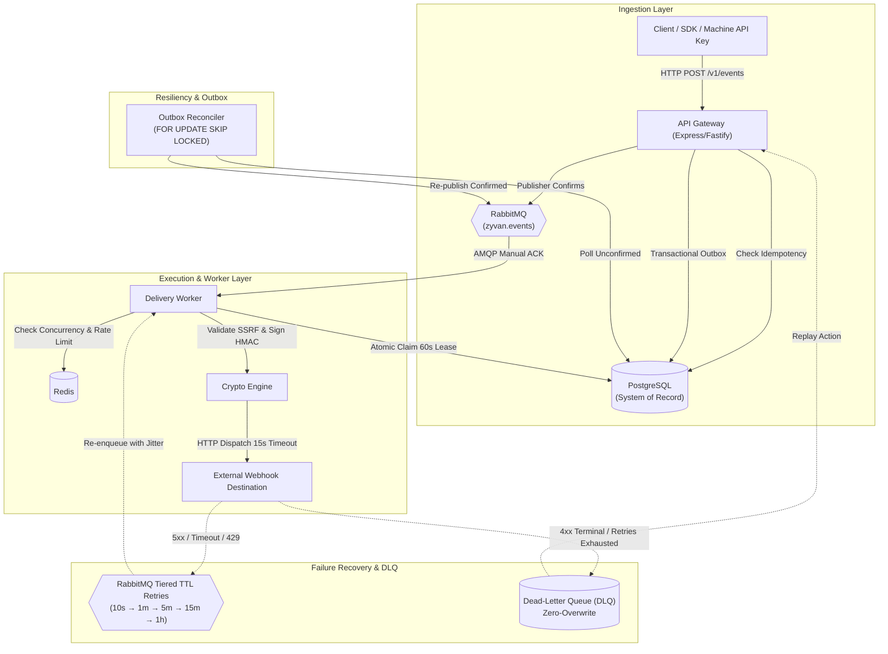
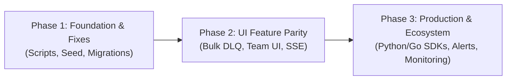

# Zyvan — Code Analysis & Remaining Work Roadmap

> **Comprehensive System Audit, Architectural Assessment, and Execution Plan**  
> *Generated on November 19, 2026*

---
Here is the complete, categorized breakdown of all technologies used across the **Zyvan** monorepo:

---

### 1. Core Languages & Runtimes
| Technology | Version / Tooling | Usage |
| :--- | :--- | :--- |
| **Node.js** | `>= 20.0.0` | Runtime environment for API, Worker, and Build tools |
| **TypeScript** | `^5.7.0` | Strict type-safety across all apps and packages |
| **TSX** | `^4.19.0` | High-speed TypeScript execution & live reload for worker dev |

---

### 2. Monorepo & Build Tooling
| Technology | Details | Usage |
| :--- | :--- | :--- |
| **Turborepo** | `turbo.json` | Monorepo pipeline orchestration, caching, and builds |
| **pnpm** | `pnpm-workspace.yaml` | Package management, symlinked workspace dependencies |
| **Base TSConfigs** | `tsconfig.base.json` | Shared compiler options and path aliases |

---

### 3. Backend API (`apps/api`)
| Layer | Technology | Purpose |
| :--- | :--- | :--- |
| **Web Framework** | **Express.js** (`^4.21.0`) | REST API routing, controllers, and middleware |
| **Authentication** | **Better Auth** (`^1.2.9`) | Multi-tenant auth, session tokens, and Org plugin |
| **Token Handling** | **jsonwebtoken** & **bcryptjs** | Signed session JWTs and secure password hashing |
| **Validation** | **Zod** (`@zyvan/validation`) | Runtime request payload, query, and environment validation |
| **HTTP Security** | **Helmet** (`^8.0.0`) & **CORS** | Security headers and cross-origin resource sharing |
| **Compression** | **compression** | Gzip/Deflate HTTP response compression |
| **Rate Limiting** | **express-rate-limit** + **ioredis** | Dual IP and Identity-scoped sliding-window rate limiters |
| **Observability** | **prom-client** | Exposes Prometheus metrics at `/metrics` |
| **Logging** | **Pino** (`pino`, `pino-pretty`) | Structured JSON logging with field redaction |
| **Outbox Reconciler** | **PostgreSQL `SKIP LOCKED`** | Durable background message publisher with 60s leases |

---

### 4. Background Delivery Worker (`apps/worker`)
| Component | Technology | Implementation Details |
| :--- | :--- | :--- |
| **Queue Consumer** | **amqplib** (`^0.10.5`) | RabbitMQ consumer with manual ACKs (`noAck: false`) |
| **Concurrency Limiter**| **Redis Leases** (`ioredis`) | Slot-based `SET NX PX` leases with atomic Lua release scripts |
| **Rate Limiter** | **Redis Sorted Sets** | Sliding 1-second window (`ZREMRANGEBYSCORE`, `ZCARD`, `ZADD`) |
| **HTTP Dispatcher** | **Node.js Fetch / AbortController** | 15s timeout, keep-alive connections, error classification |
| **SSRF Engine** | **Node.js `dns` & `net`** | Resolves IPs and blocks RFC 1918, link-local, and cloud metadata |
| **Signature Engine**| **Node.js `crypto`** | HMAC-SHA256 headers (`zyvan-signature: t=..., v1=...`) |
| **Secret Encryption**| **AES-256-GCM** | Destination signing secrets encrypted at rest |

---

### 5. Database, Cache & Message Broker
| Infrastructure | Image / Version | Configuration & Usage |
| :--- | :--- | :--- |
| **PostgreSQL** | `postgres:16-alpine` | System of record for users, orgs, events, deliveries, attempts, outbox |
| **Prisma ORM** | `@prisma/client` (`^6.8.0`) | Type-safe schema, migrations, relational queries, and transactions |
| **RabbitMQ** | `rabbitmq:3.13-management` | Message broker with topic exchange `zyvan.events` and 5 delay queues |
| **Redis** | `redis:7-alpine` | Distributed rate limiting, slot leases, and health check cache |

---

### 6. Queue & Retry Topology (`packages/queue`)
| Queue / Exchange | Routing / Delay | Behavior |
| :--- | :--- | :--- |
| **`zyvan.events`** | Topic Exchange | Root exchange for event delivery publishing |
| **`zyvan.delivery`** | `delivery.process` | Main execution queue consumed by workers |
| **`zyvan.delivery.retry.10s`** | TTL: 10,000ms | Tier 1 exponential retry |
| **`zyvan.delivery.retry.1m`** | TTL: 60,000ms | Tier 2 retry |
| **`zyvan.delivery.retry.5m`** | TTL: 300,000ms | Tier 3 retry |
| **`zyvan.delivery.retry.15m`** | TTL: 900,000ms | Tier 4 retry |
| **`zyvan.delivery.retry.1h`** | TTL: 3,600,000ms | Tier 5 retry |
| **`dead_letters` (DB)** | Terminal Status | Zero-overwrite storage for unrecoverable failures |

---

### 7. Frontend Web Dashboard (`apps/web`)
| Category | Technology | Usage |
| :--- | :--- | :--- |
| **Framework** | **Next.js 16** (App Router) | Server components, client pages, dynamic routing |
| **UI Library** | **React 19** | Concurrent rendering and hooks |
| **CSS Framework** | **Tailwind CSS v4** | Utility-first styling with modern CSS variables |
| **Icons** | **Hugeicons** & **Lucide React** | Production iconography throughout the dashboard |
| **Motion** | **Motion** (`^13.2.0`) | UI transitions and micro-interactions |
| **MDX & Diagrams** | **next-mdx-remote**, **Mermaid.js** | Markdown rendering and dynamic architecture diagrams |
| **Utilities** | **clsx**, **tailwind-merge**, **cva** | Class name merging and component variant authority |

---

### 8. Official TypeScript SDK (`packages/sdk`)
| Capability | Technology | Description |
| :--- | :--- | :--- |
| **Transport** | Native Fetch API | Universal HTTP transport (Node.js & browsers) |
| **Resilience** | Exponential Backoff & Jitter | Automatic retries on 429/5xx status codes |
| **Webhook Verifier**| HMAC-SHA256 (`crypto`) | Verify incoming signatures without external dependencies |
| **Namespaces** | Strongly Typed Resources | `events`, `destinations`, `deliveries`, `deadLetters`, `projects` |

---

### 9. Testing & Quality Assurance
| Tool | Package | Usage |
| :--- | :--- | :--- |
| **Test Runner** | **Vitest** (`^3.1.0`) | Unit, integration, reliability, and security test suites |
| **Linter** | **ESLint 9** + **eslint-config-next** | Code quality and style enforcement |

---

### 10. DevOps & Deployment
| Tool / Platform | Configuration | Purpose |
| :--- | :--- | :--- |
| **Docker & Compose** | `docker-compose.yml` | Local orchestration (PostgreSQL, Redis, RabbitMQ) |
| **Production Compose** | `docker-compose.prod.yml` | Multi-container stack (PostgreSQL, Redis, RabbitMQ, API, Worker, Web) |
| **Dockerfiles** | Multi-stage Dockerfiles | Container builds for `api`, `worker`, and `web` |
| **Vercel** | `vercel.json` | Web application deployment configuration |

## 1. System Overview & Architecture

**Zyvan** is an enterprise-grade webhook reliability engine built on an event-driven, multi-tenant architecture designed to sit between production applications and external webhook consumers.

$$\text{Application} \longrightarrow \text{Fastify/Express API} \longrightarrow \text{PostgreSQL} \longrightarrow \text{RabbitMQ} \longrightarrow \text{Delivery Worker} \longrightarrow \text{Destination}$$



---

## 2. Detailed Codebase Audit

### 2.1. Backend API (`apps/api`)
- **Routing & Controllers**: Clean modular separation (`api-keys`, `auth`, `bootstrap`, `deliveries`, `destinations`, `dlq`, `events`, `organizations`, `projects`, `replay`, `tenants`, `usage`).
- **Security Middleware**: Multi-layered security with `helmet`, IP rate limiting, identity-scoped rate limiting via Redis token bucket, Better Auth cookie/header sessions, and machine API key authentication with SHA-256 peppered hashing.
- **Transactional Outbox & Reconciler**: Ingesting an event commits both the Event, Delivery, and Outbox records atomically to PostgreSQL. The `OutboxReconciler` (`apps/api/src/services/outbox-reconciler.ts`) polls with `FOR UPDATE SKIP LOCKED`, maintaining a 60s lease with 20s heartbeats to guarantee at-least-once message delivery even during process crashes.
- **Observability**: Prometheus metrics collected via `prom-client` and exposed at `/metrics` behind `metricsAuthGuard`. Request IDs (`x-request-id`) propagated through all logs and responses.

### 2.2. Delivery Worker (`apps/worker`)
- **Stateless Consumer**: RabbitMQ consumer consuming `zyvan.delivery` with `noAck: false`.
- **Atomic Lease Management**: Delivery state machine claims deliveries using an atomic lease check (`leaseExpiresAt`) to prevent split-brain delivery.
- **Sliding-Window Rate Limiter**: Implemented using Redis Sorted Sets via Lua script (`destination-rate-limiter.ts`) to avoid boundary burst overflows.
- **Slot-Based Concurrency Limiter**: Uses Redis `SET NX PX` leases with unique UUID tokens and atomic Lua releases (`destination-concurrency.ts`), preventing concurrency counter leaks if a worker dies.
- **SSRF Prevention**: Strict DNS resolution with validation against RFC 1918 private ranges, loopback (`127.0.0.0/8`, `::1`), link-local (`169.254.0.0/16`), and AWS/GCP/Azure cloud metadata endpoints (`169.254.169.254`, `metadata.google.internal`).
- **Cryptographic Signatures**: Webhook payloads signed with HMAC-SHA256 headers (`zyvan-signature: t=<timestamp>, v1=<signature>`) with secret decryption on the fly using AES-256-GCM.

### 2.3. Retry & DLQ Architecture (`packages/queue`, `apps/worker`)
- **Exponential Backoff & Jitter**: Implements `min(baseDelay * 2^attempt + jitter, maxDelay)`.
- **AMQP Tiered Queues**: Leverages RabbitMQ dead-letter exchanges with dedicated TTL queues:
  - Tier 1: `zyvan.delivery.retry.10s` (10s TTL)
  - Tier 2: `zyvan.delivery.retry.1m` (60s TTL)
  - Tier 3: `zyvan.delivery.retry.5m` (300s TTL)
  - Tier 4: `zyvan.delivery.retry.15m` (900s TTL)
  - Tier 5: `zyvan.delivery.retry.1h` (3,600s TTL)
- **Zero-Overwrite DLQ Guarantee**: Naive retry engines mutate previous records (`attempts = 0`). Zyvan preserves every immutable attempt record in the `attempts` table and creates a fresh delivery lineage linked to the original delivery and replay batch.

### 2.4. Frontend Web Dashboard (`apps/web`)
- **Modern Stack**: Next.js 16 (App Router), React 19, Tailwind CSS v4, Lucide/Hugeicons.
- **Pages Implemented**:
  - `/dashboard`: High-level metrics, throughput and latency charts, quick test event dispatcher.
  - `/dashboard/events`: Events ledger with filtering, search, and payload inspector.
  - `/dashboard/destinations`: Webhook endpoints management, rate limit tuning, ping verification.
  - `/dashboard/dlq`: Dead-letter queue triage and replay controls.
  - `/dashboard/api-keys`: API key generator and revocation.
  - `/dashboard/simulator`: Interactive event payload simulator.
  - `/dashboard/settings`: Project and organization configuration.
- **Offline / Standalone Resilience**: `apiClient` gracefully connects to the backend on port 4000 via `/api/proxy`, and falls back to deterministic local mock data if the backend is not yet started.

### 2.5. Developer SDK (`packages/sdk`)
- Strongly typed TypeScript client supporting all resource namespaces:
  - `client.events.ingest()` / `client.events.get()`
  - `client.destinations.create()` / `client.destinations.list()`
  - `client.deliveries.get()` / `client.deliveries.listAttempts()`
  - `client.deadLetters.list()` / `client.deadLetters.replay()`
  - `client.webhooks.verifySignature()` (static and instance method)
- Built-in retry handling with exponential backoff and jitter for transient network failures.

---

## 3. Discovered Bugs & Inconsistencies

### Critical Issues

#### 1. Outdated Database Seed Script (`packages/db/prisma/seed.ts`)
The seed script was written against an earlier schema draft and is completely out of sync with [packages/db/prisma/schema.prisma](file:///d:/All%20Projects/Resume%20project/zyvan/packages/db/prisma/schema.prisma):
- References `passwordHash`, `avatar`, and `role` directly on the `User` model. The current Better Auth schema uses `image`, and stores passwords in `Account`.
- References `ownerId` and `members` on `Project`. Projects now belong to `Organization`, and members belong to `Organization`.
- References `prisma.tenant`, which does not exist in the schema.
- **Impact**: Running `npm run db:seed` fails immediately.

#### 2. Root `package.json` Database Script Path Mismatches
In [package.json](file:///d:/All%20Projects/Resume%20project/zyvan/package.json#L20-L25):
```json
"db:generate": "npx prisma generate --schema=packages/database/prisma/schema.prisma",
"db:migrate": "npx prisma migrate dev --schema=packages/database/prisma/schema.prisma",
"db:migrate:prod": "npx prisma migrate deploy --schema=packages/database/prisma/schema.prisma",
"db:push": "npx prisma db push --schema=packages/database/prisma/schema.prisma",
"db:studio": "npx prisma studio --schema=packages/database/prisma/schema.prisma",
"db:seed": "npx ts-node packages/database/prisma/seed.ts"
```
- The directory is named `packages/db`, **not** `packages/database`.
- **Impact**: Running `npm run db:generate` or `npm run db:migrate` fails with schema file not found.

#### 3. Missing Initial Prisma Migrations Directory
- In `packages/db/prisma`, there is no `migrations/` directory.
- **Impact**: Deploying via `npx prisma migrate deploy` in production containers will fail because no migrations exist yet.

#### 4. Environment Variables Omission (`JWT_SECRET`)
- In `apps/api/src/modules/auth/user-service.ts`:
  ```typescript
  const secret = config.jwtSecret || process.env.BETTER_AUTH_SECRET || 'zyvan_dev_jwt_secret_minimum_32_chars';
  ```
- `docker-compose.prod.yml` passes `JWT_SECRET`, but `JWT_SECRET` is not documented in `.env.example`.

### Architectural Redundancies

#### 5. Documentation Dual Maintenance (`apps/docs` vs `apps/web/src/app/docs`)
- There are two identical documentation implementations:
  1. Standalone Next.js app on port 3001 (`apps/docs`)
  2. Integrated routes inside `apps/web/src/app/docs` with mirrored content in `apps/web/content/docs`
- **Impact**: Edits to documentation must be made in two places, risking documentation drift.

---

## 4. Remaining Work & Implementation Roadmap



### Phase 1: Foundation & Immediate Fixes (High Priority)

| Task | Description | Files Affected |
| :--- | :--- | :--- |
| **Fix Root Scripts** | Update all `--schema=packages/database/...` to `--schema=packages/db/...` | `package.json` |
| **Rewrite `seed.ts`** | Rewrite seed script to insert `User`, `Account`, `Organization`, `Member`, `Project`, `Destination`, and `ApiKey` matching the Better Auth schema | `packages/db/prisma/seed.ts` |
| **Generate Migrations** | Run `prisma migrate dev --name init` to generate the initial migration directory | `packages/db/prisma/migrations/` |
| **Standardize `.env.example`** | Add `JWT_SECRET` and document `ENCRYPTION_KEY` requirement (32-byte hex) | `.env.example`, `.env` |
| **Consolidate Docs** | Unify documentation strategy (either deprecate `apps/docs` in favor of `apps/web/src/app/docs` or point `apps/web` docs links to `docs.zyvan.dev`) | `apps/docs`, `apps/web` |

### Phase 2: Web Dashboard Feature Completion (Medium Priority)

| Task | Description | Files Affected |
| :--- | :--- | :--- |
| **Batch DLQ Actions UI** | The backend already supports `replay-bulk`, `dismiss-bulk`, and `resolve-bulk`. Add row checkboxes and bulk action buttons in the UI. | `apps/web/src/app/dashboard/dlq/page.tsx` |
| **Organization Members & Invitations UI** | Add a "Team & Members" management view in the dashboard settings to invite members and manage roles (`owner`, `admin`, `member`, `viewer`). | `apps/web/src/app/dashboard/settings/page.tsx` |
| **Live Delivery Stream (SSE / WS)** | Implement Server-Sent Events (SSE) or WebSocket streaming from API to web dashboard so event deliveries update in real-time without manual refresh. | `apps/api/src/app.ts`, `apps/web/src/app/dashboard/page.tsx` |
| **Destination SSL & Health Verification UI** | Add an explicit "Verify SSL Handshake" and destination health check status badge in the destinations list. | `apps/web/src/app/dashboard/destinations/page.tsx` |

### Phase 3: Production Hardening & Ecosystem (Lower Priority)

| Task | Description | Files Affected |
| :--- | :--- | :--- |
| **Python & Go SDKs** | Build official client libraries for Python (`pip install zyvan`) and Go (`go get github.com/zyvan/zyvan-go`) as documented in the MDX guides. | `packages/sdk-python`, `packages/sdk-go` |
| **Destination Failure Alerting** | Implement alert webhooks / email notifications when destination error rates breach thresholds or enter dead-letter state. | `apps/worker`, `apps/api` |
| **Grafana Dashboard Templates** | Provide pre-built Grafana dashboards for RabbitMQ queue depths, delivery latency percentiles (P50, P95, P99), and DLQ rates. | `deploy/grafana/` |

---

## 5. Verification Checklist

- [ ] `npm run build` succeeds across all workspaces (`apps/*`, `packages/*`).
- [ ] `npm run test` executes all unit and integration tests across API, Worker, Auth, Crypto, and SDK.
- [ ] `docker compose up -d` starts PostgreSQL, Redis, and RabbitMQ cleanly.
- [ ] `npm run db:push` or `npm run db:migrate` applies schema without errors.
- [ ] `npm run db:seed` populates demo organization, user, project, destinations, and API keys.
- [ ] Ingesting an event (`POST /v1/events`) produces a delivery record, triggers RabbitMQ processing, and dispatches an HTTP request with HMAC verification.
- [ ] Inducing a destination failure triggers exponential backoff through `zyvan.delivery.retry.*` queues and transitions to `dead_letters` upon exhaustion.
- [ ] Triggering DLQ replay creates a fresh delivery lineage without overwriting historical attempt logs.

